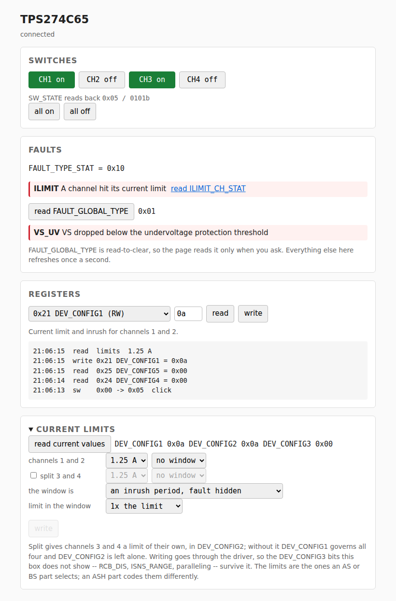

# toit-tps274c65

A minimal Toit driver for the TI
[TPS274C65](https://www.ti.com/product/TPS274C65), a quad-channel 72 mOhm smart
high-side switch with SPI control and diagnostics.

The driver speaks only the **16-bit daisy-chain** frame format (`DSPI` tied
high). It assumes **one device per chip select**, so one frame per chip-select
pulse. It also assumes the **AS** part where the variants differ
(current-limits table).

## Installation

```sh
toit pkg install github.com/girtsf/toit-tps274c65
```

Then:

```
import tps274c65
```

See `examples/*.toit`.

You can `jag run examples/webserver/main.toit` to start a web UI that shows the
switch state, decoded faults and the ADC readings, and lets you poke at
registers.



## Development

```sh
make test      # Run the unit tests.
make analyze   # Type-check src, tests and examples.
```

The screenshot above is taken by `examples/webserver/screenshot.sh`, which
serves the UI on the fake device the driver tests use, drives it with
[shot-scraper](https://shot-scraper.datasette.io/) and shoots the result. Run
it after changing the UI. It runs shot-scraper through `uvx`, so only the
headless browser has to be installed first:

```sh
uvx shot-scraper install
```

## Notes on TPS274C65

Some gotchas to watch out for:
* One frame lag for register reads in daisy chained mode. Never mentioned in
  the datasheet, with misleading frame diagrams.
* LEDs can only be turned on/off and cannot be configured to convey any device
  state.
* TPS274C65EVM has its SDI and SCLK test point labels swapped.
* Undocumented: `DEV_CONFIG1`, `DEV_CONFIG2`, `DEV_CONFIG3` and `DEV_CONFIG6`
  silently ignore writes while any channel is on.
* `FAULT_GLOBAL_TYPE` (02h) bit 7 reads back as one though the datasheet calls
  it reserved with reset 0, so a clean device reads 80h rather than 00h.

## AI Disclosure

Robots wrote most of this.
